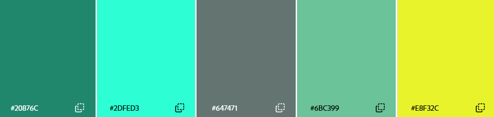

# Guía de marca · Disk Studio Suite

## Nombre

- **Disk Studio Suite**. En código y archivos se usa `DiskStudioSuite` (ejecutable `DiskStudioSuite.exe`) y el espacio de nombres `DiskStudio`.
- No se abrevia en la interfaz. «DSS» solo se usa internamente (variables de entorno de pruebas `DSS_*`, temporales `.dss-part`).
- El nombre anterior del proyecto era *Copyrobot*. Los ajustes guardados en `%APPDATA%\Copyrobot` se migran solos a `%APPDATA%\Disk Studio Suite`.

## Logo

| Archivo | Uso |
|---|---|
| `docs/marca/logo-original.jpg` | Original recibido (JPG con el fondo de cuadros incrustado). |
| `src/Assets/logo.png` | Logo con transparencia real, 1024 × 1024. |
| `src/Assets/logo-512.png` | Logo para la interfaz (menú lateral y pantalla de carga). |
| `src/Assets/app.ico` | Icono de la aplicación (16–256 px). |
| `docs/marca/extraer-logo.py` | Regenera los tres archivos anteriores a partir del original: `python docs/marca/extraer-logo.py` (requiere `pillow` y `numpy`). |

El script reconstruye el patrón de cuadros que hay detrás de cada píxel y calcula la transparencia real de los bordes (matting). Si en algún momento hay un original vectorial o un PNG transparente, conviene sustituir `logo.png` por él.

Reglas de uso:

- Deja aire alrededor del logo: al menos un 10 % de su ancho.
- Funciona sobre fondo oscuro (preferente) y claro.
- No lo deformes, no lo rotes en reposo y no le añadas contorno ni sombra dura.

## Paleta

| Color | Hex | Papel |
|---|---|---|
| Verde azulado | `#20876C` | **Principal.** Acento en tema claro: botones primarios, casillas, selección, barras de progreso, baldosas de icono. |
| Aguamarina | `#2DFED3` | **Brillo.** Texto e iconos de acento en tema oscuro, puntos luminosos, inicio del degradado de progreso. |
| Pizarra | `#647471` | **Neutro.** Baldosas y elementos secundarios (volúmenes no del sistema, estadísticas). |
| Menta | `#6BC399` | **Suave.** Acento en tema oscuro (botones primarios con texto oscuro), final de degradados. |
| Lima | `#E8F32C` | **Destacado puntual.** Detalles decorativos y final del degradado de progreso. No se usa nunca para texto sobre fondo claro. |
| Noche | `#0F2A24` | Fondo sólido de la pantalla de carga (derivado del principal). |

Degradado de marca: `#20876C → #6BC399` (baldosas). Degradado de progreso: `#20876C → #2DFED3 → #E8F32C`.

Los colores de estado no forman parte de la marca y se mantienen por legibilidad: correcto `#16A34A`, aviso `#F59E0B` y error `#DC2626`.

### Dónde está en el código

- `src/Themes/Styles.xaml`: los colores y pinceles con nombre (`BrandTeal`, `BrandBrush`, `BrandGradient`, etc.).
- `src/Brand.cs`: sustituye el color de acento de Windows en el tema Fluent por la paleta, en claro y en oscuro. Lee los tonos de acento que tenga Windows (sea cual sea el color elegido) y reemplaza todos los recursos del tema que los usan (casillas, radios, deslizadores, interruptores, barras…). Se vuelve a aplicar al cambiar de tema.

## Pantalla de carga

`src/SplashWindow.cs`. Dura unos 3,6 s y mientras tanto se detectan los discos de verdad.

- Ventana de 720 × 500 con esquinas redondeadas y fondo sólido `#0F2A24`.
- El logo entra con escala y giro suaves (efecto de rebote) y después flota de forma continua.
- Detrás del logo hay un resplandor menta que «respira».
- Tres puntos de colores de la marca orbitan alrededor de un anillo punteado que gira despacio.
- Unos cuadraditos parpadean en los laterales, como los del logo.
- El nombre y el lema («Discos · Copias · Clonado · Formato») aparecen deslizándose.
- La barra de progreso usa el degradado de marca y debajo se ven los mensajes de estado; al final aparece «N discos detectados».
- Al terminar se desvanece y se abre la ventana principal.
- Se puede omitir con el argumento `--sin-presentacion`.

## Tipografía e iconos

- Texto: Segoe UI Variable, la tipografía del sistema en Windows 11.
- Iconos: Segoe Fluent Icons (los glifos están en `src/Core/Icons.cs`).

## Tono

- Español, tratando de tú, con frases cortas y claras.
- Las acciones destructivas siempre dicen qué se va a borrar y piden confirmación escribiendo una frase.
